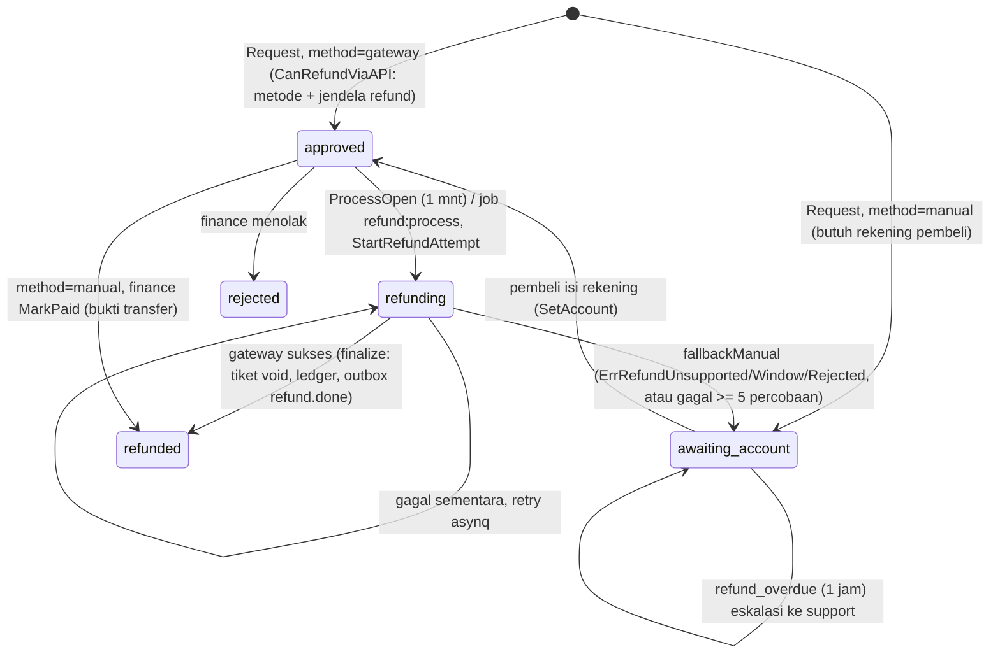
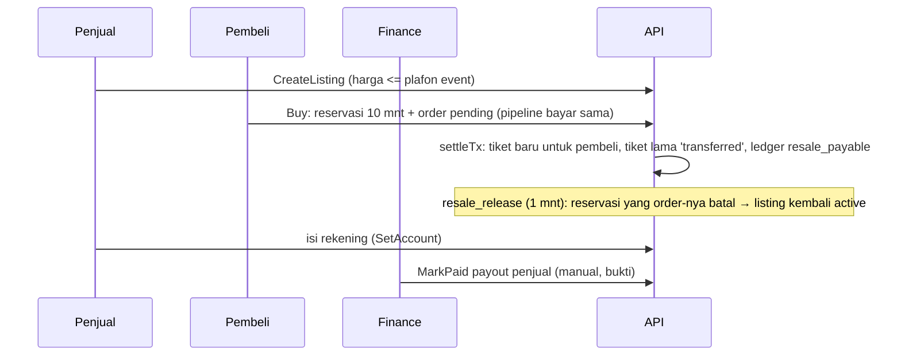

# 08 — Alur Fitur Backend (sequence diagram)

Alur per fitur, ditulis dari kode (`internal/service/*.go`). Status, kode error, loop worker, dan kejadian realtime lengkap ada di [`../../docs/references/CATALOG.md`](../../docs/references/CATALOG.md) (dibangkitkan). State machine formal: [`../../docs/11-STATE-MACHINES.md`](../../docs/11-STATE-MACHINES.md).

Konvensi: `DB` = keputusan stok/uang; `outbox` = tabel kejadian wajib-pasti; efek samping (email, cache, webhook organizer) setelah commit.

## 1. Antrean → hold → order → bayar (jalur utama)
```mermaid
sequenceDiagram
  participant C as Client
  participant API as API (Queue/Hold/Order/Payment)
  participant R as Redis
  participant DB as PostgreSQL
  participant GW as Gateway
  C->>API: POST /events/{slug}/queue/join
  API->>R: simpan peserta (pra-T0), seed di-commit (hash)
  Note over API,R: worker queue_tick (2 dtk): acak HMAC(seed,userID), admit per tick
  API-->>C: WS queue.admitted {token, expires_at}
  C->>API: POST /holds (admission token)
  API->>DB: SELECT ... ORDER BY id FOR UPDATE; AcquireSeats / UPDATE tiers WHERE sold+held+qty<=quota
  API-->>C: hold aktif (HOLD_TTL_SEC)
  C->>API: POST /orders (Idempotency-Key)
  API->>DB: order pending, harga dihitung server, kebijakan refund di-snapshot
  C->>API: POST /orders/{id}/pay
  API->>GW: buat transaksi (Snap / Invoice)
  GW-->>API: webhook (signature/token + nominal + Status API)
  API->>DB: settleTx: held→sold, tiket, invoice, ledger, outbox
  API-->>C: WS order.paid, ticket.issued (outbox), email setelah commit
```
Cabang:
- **Hold habis** (`holds_expire` 5 dtk): kursi/kuota dikembalikan, antrean `FreeSlot`.
- **Order kedaluwarsa** (`orders_expire` 10 dtk): `expired`, stok lepas.
- **Bayar setelah expire**: diterbitkan bila stok masih ada; jika tidak → refund otomatis (recon `paid_after_expire_*`).
- **Bayar ganda**: refund otomatis (recon `duplicate_payment`).
- **Webhook hilang**: `payment_reconcile` (1 mnt) cek ke gateway.
- **Gateway error saat pay**: `PAYMENT_FAILED` 502; order tetap pending.

## 2. Refund (dua jalur)

Catatan: nilai `requested` dan `refund_failed` ada di CHECK constraint tetapi **tidak pernah ditulis kode** (lihat `GAP-BE.md` G-12).
- Jalur manual tidak pernah diam-diam: `fallbackManual` mencatat audit `refund.fallback_manual` + notifikasi `refund_account_needed`; tenggat `REFUND_ACCOUNT_DEADLINE_DAYS`.
- SLA `REFUND_SLA_DAYS`; reschedule window `REFUND_RESCHEDULE_WINDOW_DAYS`.
- Retry transien: error dikembalikan ke asynq (percobaan dihitung di `refunds.attempts`).

## 3. Uang organizer: ledger → settlement → payout
```mermaid
sequenceDiagram
  participant O as Order lunas
  participant L as Ledger (double-entry)
  participant S as Worker settlement_release (5 mnt)
  participant Org as Owner organizer (MFA)
  participant F as Finance (MFA)
  O->>L: Dr payment_clearing = total; Cr org_pending = bruto - fee organizer; Cr platform_revenue = fee
  S->>L: event selesai + PAYOUT_HOLD_DAYS: Dr org_pending / Cr org_available (idempoten per event)
  Org->>L: POST payout (min PAYOUT_MIN_AMOUNT, rekening terverifikasi aktif): available → in_transit
  F->>L: Approve (bukan pemohon) → StartProcessing → MarkPaid (bukti) / MarkFailed / Reject
```
Aturan: posting idempoten `(ref_type, ref_id)`; debit = kredit (dicek di kode dan constraint trigger); pemohon tidak boleh menyetujui payout sendiri; saldo tak cukup → `VALIDATION_FAILED` dengan `details.available`. Status payout: `requested → approved → processing → paid | failed`, atau `rejected`. Rekonsiliasi gateway: `POST /admin/finance/recon/import` → `recon_exceptions`; kesehatan ledger: `Health`.

## 4. Gate scan (online) dan sinkron offline
```mermaid
sequenceDiagram
  participant G as Staf gate
  participant API as GateService
  participant DB as DB
  G->>API: POST /gate/scan {scan_id, qr}
  API->>API: evaluate (TOTP step TICKET_QR_STEP_SEC, event cocok, status valid)
  API->>DB: tandai used atomik (idempoten per scan_id)
  API-->>G: OK | DUPLICATE | INVALID | EXPIRED_CODE | WRONG_EVENT | VOID
  Note over G,API: Offline: GET manifest (secret TOTP per tiket, diaudit) → scan lokal → POST sync
  G->>API: sync [{scan_id, scanned_at, ...}]
  API->>DB: scanned_at TERAWAL menang OK; lainnya DUPLICATE_OFFLINE
```
Hasil scan adalah string `result` di respons (bukan kode error HTTP) — karena itu `TICKET_USED` tidak muncul sebagai error.

## 5. Transfer tiket
`CreateLink` (tautan klaim sekali pakai, opsional dibatasi email) → penerima `Preview` (login wajib) → `Claim`: kepemilikan pindah atomik, **secret TOTP dirotasi** (QR lama mati), rantai di `ticket_transfers`; pemilik bisa `Revoke`. Batas: `TICKET_MAX_TRANSFERS` + kebijakan event (`SetPolicy`, owner).

## 6. Resale resmi

Event batal: `reverseLedger` membalik pembukuan; bila penjual sudah dibayar, saldo negatif = piutang yang ditagih finance (recon `resale_on_cancelled_event`).

## 7. Squad checkout
Ketua `Create` (hold induk N slot) → anggota `Join` kode → `Pay`: slot dipindah ke hold anak milik anggota → order biasa → `markPaidTx` saat lunas; semua lunas → `completed`. `Extend` hanya sekali. `Sweep` (1 mnt) setelah timer habis: `release_unpaid` (bagian belum bayar dilepas) atau `cancel_all` (yang sudah bayar di-refund otomatis).

## 8. Batal / jadwal ulang event
- `Reschedule`/`Postpone` (owner + MFA): tiket tetap valid; jendela refund `on_reschedule`.
- `Cancel` / `AdminCancel` (MFA + alasan): penjualan berhenti, job `event:cancel_fanout` → `CancelEventRefunds` (refund penuh massal, idempoten) + notifikasi; `cancel_sweep` (1 mnt) menangkap bayar-setelah-batal.
- `Duplicate` menyalin info/tier/add-on/denah/kebijakan, bukan tanggal, fase, penjualan, status (selalu draft).

## 9. Realtime (outbox)
Penulis menulis `outbox(channel, topic, payload)` dalam transaksi → `outbox` loop (500 ms) `ClaimOutbox(200)` → Redis pub/sub → hub WS (melody) → klien yang `sub` pada channel; Redis mati = realtime berhenti, data tetap aman. Daftar channel/topic: CATALOG §3.

Otorisasi `sub` (`Services.AuthorizeChannel`, maks langganan per koneksi dibatasi hub; channel > 100 karakter ditolak):
| Channel | Siapa boleh |
|---|---|
| `user.<userID>` | hanya pemilik |
| `queue.<eventID>` | siapa saja, bila event `public` dan status `published`/`paused` |
| `queue.<eventID>.<userID>` | hanya pemilik (event publik) |
| `event.<eventID>` | siapa saja, event publik (stok/kursi) |
| `event.<eventID>.gate` | staf gate yang ditugaskan atau anggota organizer pemilik event |
| `org.<eventID>` | anggota organizer pemilik event (notifikasi penjualan) |
Selain itu ditolak. Ping/pong: `op: ping`.

## Sumber
`internal/service/{queue,hold,order,payment,refund,finance,ledger,gate,transfer,resale,squad,lifecycle,sched}.go`, `migrations/0003_commerce.up.sql`, `migrations/0004_finance.up.sql`.
